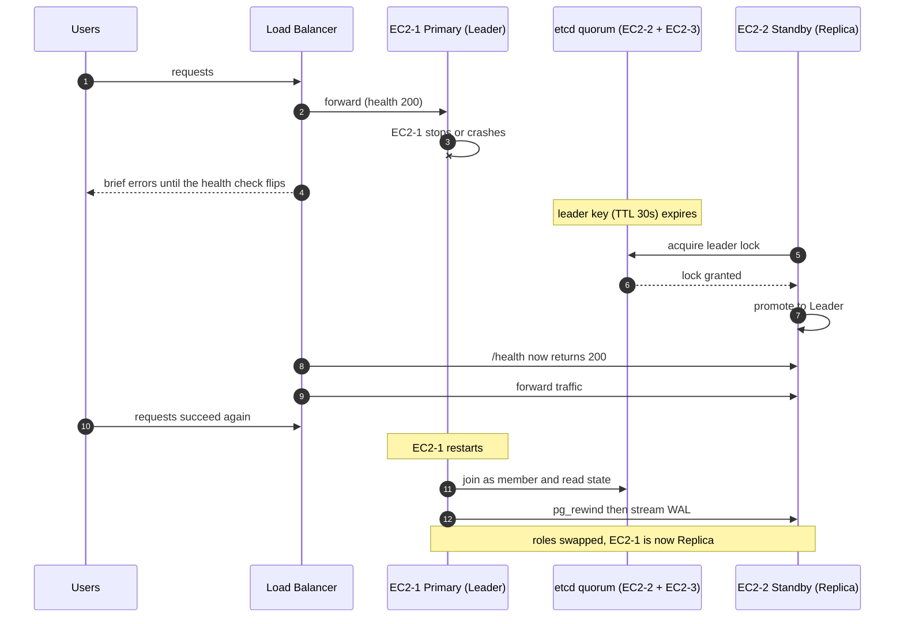
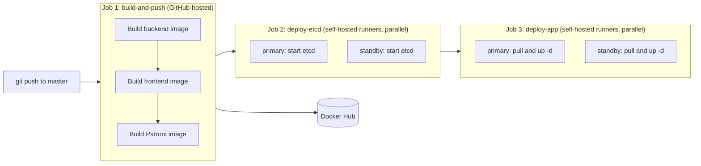

# Highly Available Distributed Banking Platform

> A two-site, self-healing application stack on AWS: **PostgreSQL + Patroni**, a **3-member etcd quorum**, **leader-aware load balancing**, and a **GitHub Actions CI/CD pipeline**, with automatic failover and automatic re-join of the failed node, all without manual intervention.


---

## Table of Contents

1. [Project Goals](#1-project-goals)
2. [Architecture](#2-architecture)
3. [How High Availability Works](#3-how-high-availability-works)
4. [Failover Walkthrough](#4-failover-walkthrough)
5. [Availability Targets: Zero Downtime, RTO and RPO](#5-availability-targets-zero-downtime-rto-and-rpo)
6. [CI/CD Pipeline](#6-cicd-pipeline)
7. [Repository Structure](#7-repository-structure)
8. [Configuration Deep Dive](#8-configuration-deep-dive)
9. [Deployment Guide](#9-deployment-guide)
10. [Failover Test Runbook](#10-failover-test-runbook)
11. [Problems I Faced and How I Solved Them](#11-problems-i-faced-and-how-i-solved-them)
12. [Known Limitations and Roadmap](#12-known-limitations-and-roadmap)
13. [Tech Stack](#13-tech-stack)
14. [Skills Demonstrated](#14-skills-demonstrated)
15. [Demo Video](#15-demo-video)

---

## 1. Project Goals

A banking-style workload cannot afford a single point of failure, so the goal was to build the smallest architecture that survives the **loss of an entire server** and recovers **without a human**.

| Goal | How it is met |
|---|---|
| No single point of failure | Two full application nodes plus a third node that exists only to hold etcd quorum |
| Automatic failover | Patroni promotes the replica when the leader lock expires |
| Automatic recovery of the failed node | The old primary restarts, rewinds with `pg_rewind`, and rejoins as a replica |
| Traffic only reaches a writable database | The `/health` endpoint returns `503` on a replica, so the load balancer only routes to the leader node |
| Repeatable delivery | Every push to `master` builds, publishes, and deploys the stack through GitHub Actions |
| Small, understandable footprint | Docker Compose per node, no orchestrator, no extra proxies |

---

## 2. Architecture

The system runs on three EC2 instances in one VPC.

| Node | Private IP | Role | Runs |
|---|---|---|---|
| EC2-1 | `172.31.38.111` | Primary site | Nginx frontend, FastAPI backend, Redis, PostgreSQL + Patroni, etcd member 1 |
| EC2-2 | `172.31.38.189` | Standby site | Nginx frontend, FastAPI backend, Redis, PostgreSQL + Patroni, etcd member 2 |
| EC2-3 | `172.31.43.188` | Witness | etcd member 3 only (quorum tie-breaker) |

### Components

| Component | Purpose |
|---|---|
| **AWS Load Balancer** | Entry point. Health-checks `GET /health` on both nodes and sends traffic only to the node that answers `200`. |
| **Nginx (frontend)** | Serves the UI and proxies API calls to the local backend. |
| **FastAPI (backend)** | REST API (`/api/transfers`, `/health`). Talks to the local PostgreSQL and Redis. |
| **PostgreSQL 16 + Patroni** | Patroni manages PostgreSQL: bootstrap, replication, leader election, promotion, and re-joining. |
| **etcd (3 members)** | Distributed configuration store (DCS). Holds the leader lock and cluster state. Raft consensus needs a majority (2 of 3). |
| **Redis** | Per-node read cache for the transfers list (60 s TTL, invalidated on every write). |
| **Docker Compose** | One compose file per node (`primary`, `standby`, `witness`). |
| **GitHub Actions + self-hosted runners** | Build images, push to Docker Hub, deploy on the EC2 instances. |

### Why three etcd members?

etcd needs a **majority** to make decisions. With only two members, losing one leaves 1 of 2, which is not a majority, so the surviving node could not promote itself. Adding a tiny third node (witness) means that losing **any one** node still leaves 2 of 3.

| Failed node | etcd quorum | Result |
|---|---|---|
| EC2-1 (primary) | EC2-2 + EC2-3 = 2 of 3 | Standby promotes |
| EC2-2 (standby) | EC2-1 + EC2-3 = 2 of 3 | Primary keeps running |
| EC2-3 (witness) | EC2-1 + EC2-2 = 2 of 3 | No impact on service |

### Network ports

| Port | Purpose | Allowed from |
|---|---|---|
| 80 | HTTP | Load balancer |
| 2379 | etcd client | EC2-1, EC2-2, EC2-3 |
| 2380 | etcd peer (Raft) | EC2-1, EC2-2, EC2-3 |
| 5432 | PostgreSQL and replication | EC2-1, EC2-2 |
| 8008 | Patroni REST API | EC2-1, EC2-2 |

---

## 3. How High Availability Works

### 3.1 Leader election with Patroni and etcd

1. Every Patroni instance tries to hold a **leader key** in etcd with a TTL of 30 seconds.
2. The node that holds the key runs PostgreSQL as **read/write leader**. The other runs it as a **streaming replica**.
3. The leader renews the key every `loop_wait` (10 s). If it stops renewing (crash, shutdown, network loss), the key expires.
4. The replica sees the key disappear, checks that it is not too far behind (`maximum_lag_on_failover`), takes the lock, and promotes itself.
5. When the old leader comes back, Patroni sees it no longer owns the lock, runs `pg_rewind` to discard any diverged WAL, and restarts it as a replica.

### 3.2 Leader-aware traffic routing

Each backend connects to its **local** PostgreSQL. Only the leader's database accepts writes, so the load balancer must send traffic only to the node whose database is the leader. The health endpoint makes that decision:

```python
@app.get("/health")
def health_check():
    try:
        conn = get_db_connection()
        cur = conn.cursor()
        cur.execute("SELECT pg_is_in_recovery();")
        is_standby = cur.fetchone()[0]
        cur.close()
        conn.close()
        if is_standby:
            return JSONResponse(status_code=503, content={"status": "standby_readonly", "node": NODE_ROLE})
        return {"status": "healthy_primary", "node": NODE_ROLE}
    except Exception as e:
        return JSONResponse(status_code=500, content={"status": "unhealthy", "error": str(e)})
```

- `200` means this node's database is the writable leader.
- `503` means the database is a replica, so the load balancer removes the node from rotation.
- `500` means the database is unreachable.

After a failover the roles swap, the health codes swap with them, and the load balancer follows the leader automatically. No DNS change and no script is involved.

### 3.3 Self-healing

All containers use `restart: always`, and the databases use persistent named volumes. A rebooted EC2 instance brings its whole stack back by itself, and Patroni handles the database role.

---

## 4. Failover Walkthrough



After the old primary has rejoined, I can return leadership to it with a planned switchover (see the runbook). Patroni does not fail back by itself, because that would cause a second, unnecessary interruption.

---

## 5. Availability Targets: Zero Downtime, RTO and RPO

I want to be precise here, because these terms are easy to over-claim.

### What "zero downtime" means in this project

- **Zero manual intervention.** Detection, promotion, traffic re-routing, and re-joining of the failed node are all automatic.
- **No service restart is required** on the surviving node. Its containers keep running; only its database role changes.
- **No data-plane reconfiguration.** The load balancer follows the leader through health checks.
- The user-visible interruption is **bounded** to the detection-and-promotion window (below). It is not literally zero for a hard crash.

### RTO (Recovery Time Objective)

| Scenario | Expected recovery |
|---|---|
| Graceful stop (instance stop, `docker stop`) | A few seconds. Patroni releases the leader key on shutdown, so the replica promotes immediately. |
| Hard crash or power loss | Worst case about 30 to 40 s: leader key TTL (30 s) + one `loop_wait` cycle (10 s), plus promotion time, plus load balancer health-check detection. |

The timing is controlled by three Patroni settings, which are tunable:

| Setting | Current | Faster profile | Constraint |
|---|---|---|---|
| `ttl` | 30 | 15 | must be at least `loop_wait + 2 × retry_timeout` |
| `loop_wait` | 10 | 5 | |
| `retry_timeout` | 10 | 5 | |

The faster profile cuts the worst case to roughly 15 to 20 s, at the cost of being more sensitive to short network hiccups, which can cause unnecessary failovers.

### RPO (Recovery Point Objective)

Patroni uses **asynchronous** streaming replication by default. On a hard crash, the most recent commits that had not reached the replica yet could be lost. Two controls limit the risk:

- `maximum_lag_on_failover: 1048576` (1 MB) prevents promoting a replica that is too far behind.
- `synchronous_mode: true` would make the RPO zero, at the cost of higher write latency and reduced availability if the replica is down. It is on the roadmap.

In my failover test, no records were lost across the primary stop and re-join.

---

## 6. CI/CD Pipeline



| Stage | Where it runs | What it does |
|---|---|---|
| `build-and-push` | GitHub-hosted runner | Builds the backend, frontend, and Patroni images and pushes them to Docker Hub. |
| `deploy-etcd` | Self-hosted runners on EC2-1 and EC2-2 | Starts only the etcd member on each node. |
| `deploy-app` | Self-hosted runners on EC2-1 and EC2-2 | Pulls the images and starts the rest of the stack. On failure it prints the etcd and database logs. |

Design decisions:

- **Self-hosted runners on the target nodes** keep the deployment simple: no SSH keys or inbound access from GitHub, just an outbound connection from each runner.
- **Two deploy stages.** The databases need all three etcd members before they can become healthy. Splitting etcd into its own earlier stage guarantees that, whatever order the two nodes pick up their jobs.
- **`fail-fast: false`** so one failing node does not cancel the other node's deployment halfway through.
- **The witness is not in the pipeline.** It runs a single etcd container that rarely changes, and it is started once by hand.

---

## 7. Repository Structure

```
.
├── .github/workflows/CI_CD.yml     build, push, and two-stage deploy
├── backend/
│   ├── Dockerfile
│   ├── app.py                      FastAPI app: /health, /api/transfers
│   └── requirements.txt
├── frontend/
│   ├── Dockerfile
│   └── index.html
├── nginx/default.conf              reverse proxy config mounted into the frontend
├── postgres-patroni/
│   ├── Dockerfile                  postgres:16-alpine + Patroni (etcd3)
│   └── entrypoint.sh               renders the Patroni config and starts Patroni
├── docker-compose-primary.yml      EC2-1: etcd + Patroni/PostgreSQL + Redis + backend + frontend
├── docker-compose-standby.yml      EC2-2: same stack, replica role
├── docker-compose-witness.yml      EC2-3: etcd only
├── docker-compose-dev.yml          local development
└── docs/architecture.png
```

---

## 8. Configuration Deep Dive

### Patroni (rendered by `postgres-patroni/entrypoint.sh`)

| Setting | Value | Why |
|---|---|---|
| `etcd3.hosts` | all three etcd client addresses | Patroni keeps working as long as any member answers |
| `ttl` | 30 | Leader key lifetime |
| `loop_wait` | 10 | How often Patroni runs its control loop |
| `retry_timeout` | 10 | Timeout for DCS and PostgreSQL operations |
| `maximum_lag_on_failover` | 1048576 | A replica more than 1 MB behind is not promoted |
| `use_pg_rewind` | true | Lets a former leader rejoin without a full re-clone |
| `use_slots` | true | Replication slots stop the leader from recycling WAL the replica still needs |
| `wal_level` | replica | Required for streaming replication |
| `hot_standby` | on | Replica serves read-only queries and answers `pg_is_in_recovery()` |
| `max_wal_senders` / `max_replication_slots` | 10 / 10 | Headroom for replicas and slots |
| `wal_keep_size` | 512MB | Extra WAL retention for a briefly disconnected replica |
| `initdb` | `data-checksums`, UTF8 | Checksums are required by `pg_rewind` |

### etcd (per node, from the compose files)

| Variable | Purpose |
|---|---|
| `ETCD_LISTEN_CLIENT_URLS` / `ETCD_LISTEN_PEER_URLS` | Bind to `0.0.0.0:2379` and `0.0.0.0:2380` |
| `ETCD_ADVERTISE_CLIENT_URLS` / `ETCD_INITIAL_ADVERTISE_PEER_URLS` | The node's private IP, which other members use to reach it |
| `ETCD_INITIAL_CLUSTER` | All three members, identical on every node |
| `ETCD_INITIAL_CLUSTER_TOKEN` | `banking-ha-cluster`, so unrelated clusters cannot merge |
| `ETCD_INITIAL_CLUSTER_STATE` | `new` for the first bootstrap |
| Volume on `/etcd-data` | Member identity and data survive container recreation |

### Container health and ordering

The backend and frontend start only when the local database is healthy:

```yaml
healthcheck:
  test: ["CMD-SHELL", "pg_isready -U postgres"]
  interval: 5s
  timeout: 5s
  retries: 30
  start_period: 25s
```

The generous retry budget covers the first deployment, when a database cannot become healthy until all three etcd members are up.

---

## 9. Deployment Guide

### Prerequisites

- Three EC2 instances (Ubuntu) in one VPC with Docker and Docker Compose installed. The witness can be very small, such as `t3.micro`.
- Security group rules from the [network ports table](#network-ports).
- A Docker Hub account and two repository secrets: `DOCKERHUB_USERNAME` and `DOCKERHUB_TOKEN`.
- A self-hosted GitHub runner on EC2-1 with label `primary` and one on EC2-2 with label `standby`. Both should show **Idle**.
- A load balancer with both EC2 instances in the target group and health check path `/health`, success code `200`.

### First deployment

1. Copy `docker-compose-witness.yml` to EC2-3 and start it:

   ```bash
   docker compose -f docker-compose-witness.yml up -d
   ```

2. Push to `master`. The pipeline starts etcd on EC2-1 and EC2-2, then deploys the application stack.
3. Verify the cluster:

   ```bash
   docker exec primary_etcd etcdctl endpoint health --cluster
   docker exec primary_db patronictl -c /tmp/patroni.yml list
   ```

   Expect three healthy etcd members, one Leader, and one Replica.

---

## 10. Failover Test Runbook

| Step | Command or action | Expected result |
|---|---|---|
| 1. Baseline | `docker exec primary_db patronictl -c /tmp/patroni.yml list` | `patroni-primary` Leader, `patroni-standby` Replica |
| 2. Health codes | `curl -s localhost/health` on each node | Primary `200 healthy_primary`, standby `503 standby_readonly` |
| 3. Write data | `POST /api/transfers` through the load balancer | Success |
| 4. Break the primary | Stop the EC2-1 instance (a force stop simulates a crash) | Failover starts |
| 5. Watch | `watch -n2 'docker exec standby_db patronictl -c /tmp/patroni.yml list'` on EC2-2 | `patroni-standby` becomes Leader |
| 6. Confirm service | `curl -s localhost/health` on EC2-2, then read and write through the load balancer | `200`, and writes succeed |
| 7. Recover | Start the EC2-1 instance | Containers come back by themselves |
| 8. Check re-join | `patronictl list` | `patroni-primary` is a Replica, lag 0, 3 etcd members healthy |
| 9. Verify data | `GET /api/transfers` | Records from before and during the outage are present |
| 10. Return leadership | `docker exec standby_db patronictl -c /tmp/patroni.yml switchover banking-cluster --leader patroni-standby --candidate patroni-primary --force` | Original layout restored |

---

## 11. Problems I Faced and How I Solved Them

These are the real issues I debugged while building this. Each one taught me something about operating distributed systems.

### 11.1 etcd crash loop: truncated listen URL

- **Symptom.** Deployments hung for minutes, then failed. The etcd logs repeated `invalid value "http://0.0.0" for ETCD_LISTEN_PEER_URLS`.
- **Root cause.** The listen URLs in the compose file were `http://0.0.0`, missing the last octet and the port. etcd refused to start, and `restart: always` made it retry forever, which made the problem look like a hang rather than a crash.
- **Fix.** `http://0.0.0.0:2379` for client URLs and `http://0.0.0.0:2380` for peer URLs.
- **Lesson.** A restart policy can hide a crash loop. Read the first error in the logs, not the symptom in the pipeline.

### 11.2 Single etcd node was a single point of failure

- **Symptom.** The design promised automatic failover, but etcd ran only on the primary. If the primary died, the standby would lose the configuration store and could not promote.
- **Root cause.** Patroni needs a **quorum** in the DCS. One member on the failing node means no quorum when it matters most. Two members is no better: losing one still leaves no majority.
- **Fix.** A three-member etcd cluster across the primary, the standby, and a small witness instance. Every Patroni instance lists all three endpoints.
- **Lesson.** Quorum systems need an odd number of members. The witness costs very little and is what makes the failover real.

### 11.3 Wrong IP address for the witness

- **Symptom.** The witness etcd started but never joined the cluster.
- **Root cause.** I had used a placeholder private IP in the cluster definition. The real private IP of the new instance was different, so the other members advertised and dialed an address that did not exist.
- **Fix.** I read the real IP from the instance hostname (`ip-172-31-43-188`) and corrected it in all three compose files, then restarted the witness with a clean volume.
- **Lesson.** Every address in an etcd `initial-cluster` must match exactly on every member. I now verify IPs with `grep` across all files before pushing.

### 11.4 The pipeline deployed an old file

- **Symptom.** Despite my fixes, the CI logs still showed the old values: data directory `/etcd-data-single`, token `banking-ha-single`, volume `v3`.
- **Root cause.** The corrected compose files were modified locally but never committed. The last commit only touched `app.py`, so the runner checked out the old compose files.
- **Fix.** `git status` showed the uncommitted changes. I committed and pushed them.
- **Lesson.** When logs do not match what you think you deployed, compare values from the logs with the file in the commit being deployed, and check which commit the run is actually using.

### 11.5 Broken `/health` endpoint

- **Symptom.** A review of the code showed that `/health` used `JSONResponse` and `NODE_ROLE`, but neither was imported or defined.
- **Root cause.** The endpoint would have raised a `NameError`, so every node would have looked unhealthy to the load balancer.
- **Fix.** Import `JSONResponse` and read `NODE_ROLE` from the environment.
- **Lesson.** The health endpoint is the most important code path in an HA system. It needs its own test.

### 11.6 A replica still looked healthy to the load balancer

- **Symptom.** A health check that only tested the database connection would return `200` on a read-only replica, so writes could be routed to a node that cannot accept them.
- **Root cause.** A connection check says the database is up. It does not say the database is writable.
- **Fix.** The endpoint runs `SELECT pg_is_in_recovery();` and returns `503` on a replica. Only the leader node passes, so the load balancer follows the leader after every role change.
- **Lesson.** A health check should answer "can this node do its job?", not "is the process alive?".

### 11.7 etcd refused to start: "member has already been bootstrapped"

- **Symptom.** The primary's etcd exited with `member ... has already been bootstrapped`.
- **Root cause.** I had wiped the primary's etcd data, but the other members still remembered it as part of an earlier cluster. A new member claiming a bootstrap identity that the cluster already knows is rejected.
- **Fix.** Remove the state of **all** members together (containers and volumes on all three nodes) and bootstrap the cluster from zero. This was safe because no real data existed yet.
- **Lesson.** etcd member state must stay consistent across the cluster. Wiping one member is never a clean reset. Rejoining an existing cluster uses a different procedure from bootstrapping a new one.

### 11.8 Patroni: "Etcd version 3.0.0 is lower than 3.1.0"

- **Symptom.** With only two of three etcd members running, Patroni on the primary logged `Detected Etcd version 3.0.0 is lower than 3.1.0` and `'int' object has no attribute 'get'`, and PostgreSQL never started.
- **Root cause.** This was not a version problem. Without quorum, etcd could not finish negotiating its cluster version and reported 3.0, which Patroni cannot use. The real cause was the standby's etcd not running.
- **Fix.** Starting the third member restored quorum, the cluster moved to version 3.5, and the errors disappeared.
- **Lesson.** A misleading error message can be a symptom of a missing quorum. The etcd peer logs (`connection refused` on port 2380 of the standby) pointed to the real cause.

### 11.9 Stale database volumes from earlier attempts

- **Symptom.** Risk of PostgreSQL system-ID mismatches between the primary and the standby after several failed bootstraps.
- **Root cause.** Each node may have initialized its own cluster during earlier attempts. Patroni refuses to attach a replica whose system ID differs from the leader's.
- **Fix.** New volume names (`pg_primary_patroni_v4`, `pg_standby_patroni_v4`, `etcd_*_v1`) so the next deployment starts from a clean state without needing manual access to the servers.
- **Lesson.** For stateful services, treat the volume as part of the configuration. When the state is suspect, start from a clean, versioned volume.

### 11.10 Pipeline race: the primary waited for a standby that never started

- **Symptom.** The primary deployment waited about three minutes and failed, while the standby job sat in "queued" and then showed "cancelled".
- **Root cause.** Three things combined:
  1. The database healthcheck on the primary needs all three etcd members, which includes the standby's.
  2. Matrix jobs run in parallel, but a self-hosted runner only picks up jobs when it is idle and online.
  3. GitHub's default `fail-fast` cancels the sibling job when one job fails, so the standby never got its chance.
- **Fix.** I split deployment into `deploy-etcd` and `deploy-app` (etcd on both nodes first, then the application stack), set `fail-fast: false`, and checked that both runners show **Idle**.
- **Lesson.** In a cluster, deployment order is part of the design. A dependency between nodes belongs in the pipeline as an explicit stage.

### 11.11 Smaller issues

| Issue | Resolution |
|---|---|
| Patroni `hosts` as a YAML list with one comma-separated string | Pass the endpoints as one quoted, comma-separated string |
| Healthcheck window too short for the first deployment | `retries: 30` with `start_period: 25s` |
| `__pycache__` committed to Git | Added to `.gitignore` and removed from tracking |
| GitHub returned "Internal server error" on a run | Platform-side error. Re-running the jobs fixed it. |
| Typo in a command (`docekr`) cost a few minutes | Use shell history and copy-paste for runbook commands |

---

## 12. Known Limitations and Roadmap

Being clear about the limits is part of the design.

| Area | Current state | Planned improvement |
|---|---|---|
| Data loss on hard crash (RPO) | Asynchronous replication may lose the last few commits | Enable `synchronous_mode` for RPO = 0 on critical data |
| Deployments | `docker compose up -d` on both nodes in parallel can briefly interrupt service when containers are recreated | Rolling deployment one node at a time (`max-parallel: 1`), replica first, then switchover |
| Image versions | `latest` tags | Tag images with the commit SHA and pin them in compose files |
| Secrets | Database password is in the compose files | GitHub secrets or AWS Secrets Manager |
| etcd traffic | Plain HTTP inside the VPC | TLS and authentication for etcd, TLS for PostgreSQL |
| PostgreSQL access | `pg_hba` allows `0.0.0.0/0` with `md5`, protected by security groups | Restrict to VPC CIDRs |
| Redis | Per-node cache, not replicated | Treat as disposable, or move to a managed, replicated cache |
| Cache serialization | The transfers cache is read back with `eval` | Switch to JSON (`json.dumps` / `json.loads`) |
| Observability | Logs and `patronictl` only | Prometheus and Grafana (Patroni and etcd metrics), alerts on leader changes |
| Tests | Manual failover test | Automated chaos test in CI against a staging copy |
| Region resilience | One VPC, one region | Multi-AZ placement, then a second region with asynchronous replication |

### Relevance to MLOps

MLflow's tracking server and model registry use a SQL backend store, and model-serving platforms depend on the same kinds of stateful services. This project is the pattern I use to make such a backend resilient: a replicated PostgreSQL with automatic failover, quorum-based coordination, health-driven routing, and a pipeline that deploys it repeatably.

---

## 13. Tech Stack

| Area | Technology |
|---|---|
| Cloud | AWS EC2, Elastic Load Balancer, VPC security groups |
| Containers | Docker, Docker Compose |
| Database HA | PostgreSQL 16, Patroni, streaming replication, `pg_rewind` |
| Coordination | etcd v3.5.15 (3-member Raft cluster) |
| Backend | Python, FastAPI, psycopg2, Redis |
| Frontend / proxy | Nginx |
| CI/CD | GitHub Actions (hosted and self-hosted runners), Docker Hub |

---

## 14. Skills Demonstrated

- Designing a **quorum-based** architecture and reasoning about failure modes (which node can fail, and what survives)
- Operating **Patroni, etcd, and PostgreSQL replication** hands-on, including recovery and switchover
- Building **health-driven routing** so traffic follows the writable node
- Structuring a **multi-node CI/CD pipeline** with explicit deployment stages and self-hosted runners
- **Root-cause debugging** across logs from several layers (pipeline, container, etcd, Patroni, application)
- Honest **trade-off analysis**: RTO and RPO, security and availability, simplicity and completeness

---

## 15. Demo Video

https://drive.google.com/file/d/12ath2s6tzCW4qppnxc1Udhjg6Kuh1fBd/view?usp=sharing

What the demo shows:

1. The healthy cluster: 3 etcd members, one Leader, one Replica
2. A write through the load balancer
3. Stopping the primary instance
4. The standby promoting itself and the load balancer following it
5. Reads and writes continuing during the outage
6. Starting the primary again and watching it rejoin as a replica
7. Verifying that no data was lost
8. A planned switchover back to the original primary

Measured failover time in my run: **`__ seconds`** (fill in from the recording)

---

*Built and tested end to end on AWS by Abdullrahman Eissa.*
